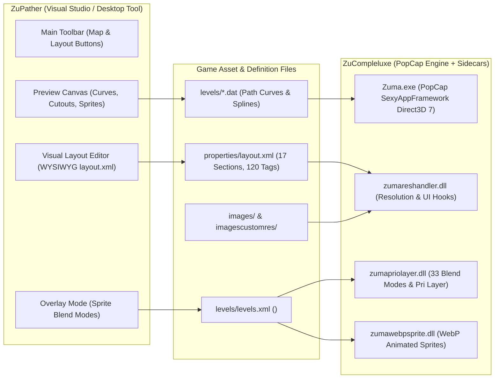

# Zuma Engine Mechanics & ZuPather Integration Master Specification

> **Target Audience**: AI Coding Assistants, Engine Reverse Engineers, and Developers working on **ZuPather** (`ZuPather - Zuma Deluxe Path Maker`).
> **Authority**: Sourced directly from decompiled vanilla `Zuma.exe` (PopCap Games v1.0.0.1) and the **ZuCompleluxe** native runtime hooks (`zumareshandler.dll`, `zumapriolayer.dll`, `zumawebpsprite.dll`, `zumaextrapath.dll`, `zumaextracolor.dll`).
> **Goal**: Provide the complete engineering context, mathematical formulas, memory layout conventions, and UI implementation requirements so that ZuPather seamlessly mirrors Zuma Deluxe and ZuCompleluxe runtime behavior.

---

## 1. Executive Ecosystem Context



### The Two Halves of the Ecosystem
1. **ZuCompleluxe (The Runtime Engine)**:
   - A modified, reverse-engineered version of PopCap's *Zuma Deluxe 1.0.0.1*.
   - Injects custom PE sections (`.zdata`, `.zldr`, `.zcol`, `.anim`, `.zep`, `.zcm`, `.zcc`, `.ztk`, `.zprio`, `.zres`) to load modular C sidecar DLLs.
   - Executes the game loop, parses XML at startup, hooks Direct3D/DirectDraw, manages memory coordinates, and renders graphics at arbitrary widescreen resolutions (e.g., `1200x675`, `1920x1080`, `4K`).
2. **ZuPather (The Visual Content Creation Suite)**:
   - A high-performance, native Win32/C desktop authoring application.
   - Provides visual editors for Curve Tracks (`.dat`), Level Progression (`levels/levels.xml`), Sprite Layers with 33 Blend Modes (`Ctrl+Shift+O`), and the Visual Layout Editor (`properties/layout.xml`).
   - **Cardinal Rule**: ZuPather **must never guess** or extrapolate coordinates or blend modes. Everything created in ZuPather must strictly adhere to the mathematical laws of `Zuma.exe` and `ZuCompleluxe`.

---

## 2. Zuma.exe Engine Internal Mechanics

### 2.1 Coordinate Systems & Resolution Pipelining
Vanilla *Zuma Deluxe* was built for a fixed **640x480** (4:3) resolution. In **ZuCompleluxe**, arbitrary widescreen resolutions (such as `1200x675` or `1920x1080`) are introduced via two distinct rendering spaces:

#### A. In-Game Gameplay Canvas (`Board::Draw`)
- Background assets (`imagescustomres/*.jpg`) are loaded at full target canvas size (e.g., `1200x675`).
- The playable board coordinates (curve paths, frog pad `(gx, gy)`, coin points) remain defined in `640x480` logical space.
- In widescreen mode:
  - An offset matrix is calculated:
    $$\text{Scale } S = \frac{\text{TARGET\_H}}{480.0}$$
    $$\text{Content Width } W_c = 640.0 \times S$$
    $$\text{Offset } X_{\text{off}} = \frac{\text{TARGET\_W} - W_c}{2}$$
    $$\text{Offset } Y_{\text{off}} = 0$$
  - At `1200x675`: $S = 675 / 480 = 1.40625$, $W_c = 900\text{px}$, $X_{\text{off}} = (1200 - 900)/2 = 150\text{px}$.

#### B. Menus, Dialogs, and Screens (`MainMenu`, `AdventureScreen`, `GauntletScreen`, etc.)
- All UI screens in PopCap framework are derived from `Widget`.
- In widescreen, menu screens are placed inside a **pillarboxed widget container** sized at $900 \times 675$ and positioned at screen offset $(X_{\text{off}}, 0) = (150, 0)$.
- Within the screen's `Draw(Graphics* g)` function:
  - Coordinate $(0, 0)$ is **local to the widget** (which translates to screen coordinate $(150, 0)$).
  - Every coordinate from `properties/layout.xml` is scaled using:
    $$\text{PARENT\_LOCAL\_X}(v) = \text{round}(v \times S)$$
    $$\text{PARENT\_LOCAL\_Y}(v) = \text{round}(v \times S)$$
  - Example: A button defined at `x="434"` in canonical 4:3 is placed at local $X = \text{round}(434 \times 1.40625) = 610\text{px}$ inside the widget, rendering on screen at $150 + 610 = 760\text{px}$.

### 2.2 PopCap Sprite Blitting Laws
> [!IMPORTANT]
> **Sprite Dimensions Are NEVER Runtime-Scaled by Software!**
> `Graphics::DrawImage(img, x, y)` and `Graphics::DrawImageCel(img, x, y, cel)` blit images at **exact 1:1 pixel fidelity**:
> - If an asset exists in `imagescustomres/` (e.g., `mmscreen.jpg`, `advstage.gif`), `Zuma.exe` loads the pre-upscaled file directly.
> - If an asset only exists in `images/` (e.g., `smallfrogonpad.gif`, `hole.gif`, `coin.gif`), it is drawn at its native pixel dimensions (e.g. `75x75`, `82x81`, `30x30`).
> - In ZuPather, the canvas destination rectangle for a sprite cel must always use:
>   $$\text{dst\_w} = \text{round}\left(\frac{\text{img.width}}{\text{cols}} \times vscale\right), \quad \text{dst\_h} = \text{round}\left(\frac{\text{img.height}}{\text{rows}} \times vscale\right)$$

### 2.3 PopCap Text & Font Engine
- PopCap uses bitmap fonts (`ImageFont`) parsed from `.txt` descriptor files and associated sprite sheets in `fonts/`.
- `Graphics::DrawString(str, x, y)`:
  - $x$ represents the **left edge** of the string.
  - $y$ represents the **top bounding edge** of the string (the baseline is at $y + \text{Font::GetAscent()}$).
- `Widget::WriteWordWrappedText(g, rect, str, lineSpacing, justification)`:
  - Intercepted at virtual table offset `0x88` (34th entry).
  - Automatically wraps text when the accumulated character width exceeds `rect.mWidth`.
  - Used for Gauntlet Mode description boxes, Adventure InfoBox, and help dialogs.

---

## 3. The `properties/layout.xml` Architecture

### 3.1 Structure & Tag Catalog (17 Sections, 120 Tags)
`properties/layout.xml` provides full external control over all UI coordinates without recompiling the executable.

| Section | XML Tag | Description & Critical Notes |
| :--- | :--- | :--- |
| **1. In-Game HUD** | `<InGameHUD>` | Contains `<LivesBanner>`, `<LevelBanner>`, `<Menubar>`, `<LivesPos>`, `<StageName>`, `<ScoreText>`, `<ProgressBar>`, `<MenuBtn>`, `<MenubarMargins>`. |
| **2. Main Menu** | `<MainMenu>` | Button positions (Arcade, Gauntlet, Options, etc.), frog eyes (`<Eyes>`, `<EyeIdle1>`, `<EyeIdle2>`, `<EyeRay1>`, `<EyeRay2>`, `<Blink>`), `<Hat>`, `<Sun1>`, `<Sun2>`. |
| **3. Main Menu Greeting** | `<MainMenuLabels>` | `<WelcomeText>`, `<UserSwitchText>`. |
| **4. Adventure Labels** | `<AdventureLabels>` | `<AdventureTitle x="0" y="0" />`, `<HighscoreTitle>`, `<HighscoreNames>`, `<HighscoreScores>`, `<HighscoreRow>`, `<StageNum>`, `<InfoBox>`. |
| **5. Adventure Doors** | `<AdventureDoors>` | Doors 0..3 with paired points `(x1, y1, x2, y2)`. |
| **6. Secret Stage 13** | `<AdventureSecretStage13>` | Badge, Title, and Subtitle coordinates for the secret 13th temple. |
| **7. Gauntlet Doors** | `<GauntletDoors>` | Doors 0..3 base coordinates `(x, y)`. |
| **8. Gauntlet Nav** | `<GauntletNavButtons>` | Navigation buttons (`Practice`, `Survival`, `Back`, `MainMenu`, `Next`, `Play`) with 9-point alignment. |
| **9. Gauntlet Labels** | `<GauntletLabels>` | `<GauntletTitle>`, `<DoorFrame>`, `<HighscoreTitle>`, `<DoorName>`, `<PracticeText>`, `<CustomMapTag>`, `<Gem>`, `<HighscoreScores>`, `<HighscoreNames>`, `<HighscoreRow>`, `<HighscoreClip>`, `<InfoBox>`. |
| **10. Dialogs** | `<DialogLayout>` | Universal dialog sizing, button layouts (`OK`, `Cancel`), header labels, checkbox coordinates. |
| **11. Help Screen** | `<HelpScreen>` | Instruction graphics, 5 text tutorial compartments, checkboxes, and `<DoneBtn>`. |
| **12. Loading Screen** | `<LoadingScreen>` | `<LoadingText>`, `<ClickToPlayBtn>`, `<LoaderBar>`. |
| **13. More Games** | `<MoreGamesScreen>` | Frame and game icon grid positions. |
| **14. Credits Screen** | `<CreditsScreen>` | Scroll starting positions, text centering, and happy ending face coordinates. |
| **15. Stage Complete** | `<StageComplete>` | Bonus tally ledger baselines, frog waypoint animations (`bx`, `cx`, `dx`, `target`). |
| **16. Temple Cleared** | `<TempleComplete>` | Deity dialog boxes (`<DialogText>`, `<FrogReply>`). |
| **17. Developer Testing** | `<DevHelp>` | Testing kit overlay coordinate anchors. |

### 3.2 High Scores Table Rendering Sequence
A critical discovery in `Zuma.exe` reverse-engineering is the high-score rendering sequence:
```
1. Font & Color initialized.
2. SCORES Loop (Iterates rows 0..2 or 0..4):
   - Calculates Y = BaseY + row * spacing.
   - Pushes X = ScoresX.
   - Calls Graphics::DrawString(g, score_str, X, Y).  <-- SCORES ARE DRAWN FIRST!
3. Graphics::SetClipRect(0, 0, ClipW, ScreenH):
   - Sets clipping boundary (default ClipW = 567 in 4:3, 797 in 1200x675).
4. NAMES Loop (Iterates rows 0..2 or 0..4):
   - Calculates Y = BaseY + row * spacing.
   - Pushes X = NamesX.
   - Calls Graphics::DrawString(g, name_str, X, Y).   <-- NAMES ARE DRAWN INSIDE CLIP RECT!
```
* **Lesson for ZuPather**: Scores are drawn **before** the clip rect is applied, while player names are drawn **after** `SetClipRect`. ZuPather's layout preview must render scores without clipping and names clipped at `ClipW`.

---

## 4. Sprite Layer 33 Blend Modes Engine (`zumapriolayer.dll`)

### 4.1 The Technical Architecture
Direct3D 7 fixed-function rendering cannot perform non-linear blending (like Overlay, Color Dodge, or Soft Light) without severe alpha haloing. In **ZuCompleluxe v0.6**, `modules/zumapriolayer.dll` intercepts sprite drawing calls, executes a non-blocking DirectDraw surface lock (`Lock(NULL, &desc, DDLOCK_WAIT, NULL)`), and computes pixel math directly on 32-bit ARGB framebuffer pixels.

### 4.2 Supported Blend Modes Reference Table
ZuCompleluxe supports all **33 Serif Affinity / Photoshop** blend modes:

| Category | Supported Modes (`blend="..."`) | Mathematical Core Equation |
| :--- | :--- | :--- |
| **Normal** | `normal`, `dissolve` | Standard W3C source-over alpha blending. |
| **Darken** | `darken`, `multiply`, `colorburn`, `linearburn`, `darkercolor` | $\text{Multiply}: f(a,b) = \frac{a \times b}{255}$<br>$\text{Color Burn}: f(a,b) = 255 - \left(\frac{(255 - b) \times 255}{a}\right)$ |
| **Lighten** | `lighten`, `screen`, `colordodge`, `lineardodge`, `lightercolor` | $\text{Screen}: f(a,b) = a + b - \frac{a \times b}{255}$<br>$\text{Color Dodge}: f(a,b) = \frac{b \times 255}{255 - a}$ |
| **Contrast** | `overlay`, `softlight`, `hardlight`, `vividlight`, `linearlight`, `pinlight`, `hardmix` | $\text{Overlay}: \begin{cases} \frac{2 \times a \times b}{255} & b < 128 \\ 255 - \frac{2 \times (255-a)(255-b)}{255} & \text{otherwise} \end{cases}$ |
| **Inversion** | `difference`, `exclusion`, `subtract`, `divide` | $\text{Difference}: f(a,b) = |b - a|$<br>$\text{Divide}: f(a,b) = \frac{b \times 255}{a}$ |
| **Component** | `hue`, `saturation`, `color`, `luminosity` | RGB $\leftrightarrow$ HSL color space conversion and transfer. |
| **Special** | `average`, `negation`, `reflect`, `glow`, `freeze`, `heat` | Extended non-linear artistic blending. |

### 4.3 Cardinal Modder Rule
> [!IMPORTANT]
> **Use `<Sprite>`, NEVER `<Cutout>` for Blend Modes!**
> ```xml
> <!-- CORRECT: Dynamic 32-bit blending in ZuCompleluxe -->
> <Sprite id="glow_layer" x="0" y="0" pri="12" blend="glow" />
>
> <!-- INCORRECT: Cutouts do not support non-linear blend modes -->
> <Cutout id="glow_layer" x="0" y="0" pri="12" blend="glow" />
> ```

---

## 5. ZuPather Actionable Implementation Blueprint

Any AI or developer working on **ZuPather** must implement the following tasks:

### Task 1: "Layout" Button in Top Toolbar (`zupather_ui.c`)
- **Visual Location**: Place the "Layout" button (`g_btn_manage_layout`) immediately to the left of the "Map" button (`g_btn_manage_maps`).
- **Geometry**: Height `26px`, dynamically calculated width matching font metrics (padding `16px`).
- **Action**: Clicking "Layout" calls `show_layout_editor_dialog(g_hwnd_main)` from [`src/layout_editor.h`](file:///D:/Files/Project/Reverse%20Engineer/ZuPather%20-%20Zuma%20Deluxe%20Path%20Maker/src/layout_editor.h).
- **Keyboard Shortcut**: Register `Ctrl+L` or `Ctrl+Shift+L` to invoke the Layout Editor dialog.
- **Visual Style**: Clean owner-drawn button matching the dark Aztec theme with active/hover feedback.

### Task 2: Blend Mode Support in Overlay Mode (`Ctrl+Shift+O`)
- **Inspector UI**: In Overlay Mode, when an overlay layer is selected, provide a **Blend Mode dropdown / combo box** populated with the 33 supported blend modes.
- **Serialization**: Save and load the `blend="..."` attribute losslessly in `levels/levels.xml` inside `<Sprite ...>` tags:
  ```xml
  <Sprite id="layer_aurora" x="0" y="0" pri="10" blend="screen" />
  ```
- **Real-Time Canvas Blitter (`canvas_render.c`)**: Implement a 32-bit software blending routine in ZuPather's canvas engine matching the equations in [`ZUMA_OVERLAY_BLEND_MODES_SPECIFICATION.md`](file:///D:/Files/Project/Reverse%20Engineer/ZuPather%20-%20Zuma%20Deluxe%20Path%20Maker/docs/ZUMA_OVERLAY_BLEND_MODES_SPECIFICATION.md), so the preview canvas displays the true in-game visual look in real time.

### Task 3: 100% Visual Parity in Layout Editor (`src/layout_editor.c`)
- Support all **17 sections** and **120 elements** listed in [`ZUMA_UNMAPPED_AND_EXTENDED_LAYOUT_ELEMENTS.md`](file:///D:/Files/Project/Reverse%20Engineer/ZuPather%20-%20Zuma%20Deluxe%20Path%20Maker/docs/ZUMA_UNMAPPED_AND_EXTENDED_LAYOUT_ELEMENTS.md).
- **Multi-Resolution Preview**: Allow toggling preview between Canonical `640x480` (4:3) and Widescreen `1200x675` (HD Mode).
- **Asset Loading Resolution Rule**: Always check `imagescustomres/<file>` first. If missing, fall back to `images/<file>` at **1:1 unscaled pixel dimensions**.
- **Lossless XML Preservation**: When saving back to `properties/layout.xml`, preserve existing XML formatting, comments, and structure.

---

## 6. Verification & Safety Protocol

1. **Local Only (User Rule 4)**: All code modifications, builds, and testing must strictly remain **100% local**. Never perform `git push`, tag updates, or release uploads without explicit user instructions.
2. **Build Toolchain**:
   - Compilation: Execute `build_windows.bat` in `D:\Files\Project\Reverse Engineer\ZuPather - Zuma Deluxe Path Maker`.
   - Executable Target: `ZuPather.exe`.
3. **Cross-Check with ZuCompleluxe**:
   - When modifying `layout_editor.c`, always verify that generated XML loads cleanly in `Zuma Compleluxe` without throwing XML syntax errors or misaligning UI widgets.
